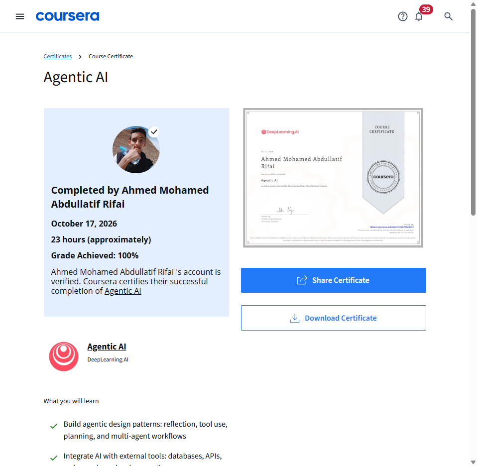
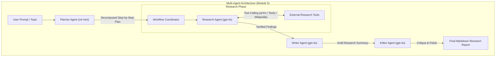

# Agentic AI — DeepLearning.AI

Official coursework, implemented reflective agent pipelines, tool-calling systems, multi-agent workflows, and verified certificate for **Agentic AI** offered by **DeepLearning.AI** on Coursera.

---

## 🎓 Credential Verification

- **Learner:** Ahmed Mohamed Abdullatif Rifai
- **Issuer:** DeepLearning.AI & Coursera
- **Certificate ID:** `TF20P782D3SY`
- **Verification URL:** [coursera.org/verify/TF20P782D3SY](https://www.coursera.org/account/accomplishments/verify/TF20P782D3SY)
- **Completion Date:** October 17, 2026
- **Final Grade:** **100.00%** (All graded programming assignments scored 100/100)

---

## 📂 Repository Contents

| Notebook / File | Module | Grade | Description |
| :--- | :--- | :---: | :--- |
| [`C1M2_Assignment.ipynb`](./C1M2_Assignment.ipynb) | Module 2 | **100/100** | **Reflection in a Research Agent:** Implemented a three-step reflective workflow (`generate_draft`, `reflect_on_draft`, `revise_draft`) using LLM self-critique. |
| [`C1M3_Assignment.ipynb`](./C1M3_Assignment.ipynb) | Module 3 | **100/100** | **Tool Use and Reflective Agents:** Integrated arXiv and Tavily web search tools with OpenAI function calling, structured JSON critique, and automated HTML publishing. |
| [`C1M5_Assignment.ipynb`](./C1M5_Assignment.ipynb) | Module 5 | **100/100** | **Agentic Workflows:** Orchestrated a complete autonomous multi-agent pipeline (`planner_agent`, `research_agent`, `writer_agent`, `editor_agent`) to conduct research and generate polished Markdown reports. |
| [`DeepLearning_AI_Agentic_AI_Certificate_TF20P782D3SY.pdf`](./DeepLearning_AI_Agentic_AI_Certificate_TF20P782D3SY.pdf) | Credential | **100%** | Official vector Coursera credential PDF. |

---

## 🏗️ Architecture & Agentic Design Patterns

---

## 🔑 Key Skills Acquired

- **Agentic Workflows & Design Patterns:** Task decomposition, iterative self-reflection, critique generation, and revision loops.
- **Function Calling & Tool Integration:** Dynamic tool execution (`arXiv`, `Tavily`, `Wikipedia`) with automated error recovery.
- **Autonomous Multi-Agent Orchestration:** Role specialization (Planner, Researcher, Writer, Editor) with structured inter-agent communication.
- **Structured LLM Outputs:** Enforcing deterministic JSON schema responses and clean programmatic output handling.
