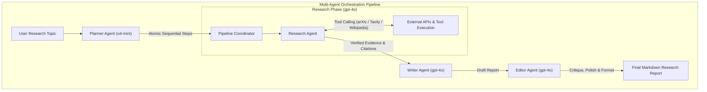

# 🤖 Agentic AI — DeepLearning.AI Study Hub & Applied Workflows

[](https://www.python.org/)
[](https://www.deeplearning.ai/)
[](https://openai.com/)
[](https://opensource.org/licenses/MIT)

> **Learner:** Ahmed Rifai  
> **Course:** DeepLearning.AI — Agentic AI  
> **Repository Purpose:** Comprehensive study repository, laboratory notebooks, modular agent architectures, and technical notes documenting my deep-dive into autonomous AI agent design patterns.

---

## 📖 Overview & Study Focus

This repository tracks my hands-on coursework, architectural patterns, and code implementations throughout **DeepLearning.AI's Agentic AI** curriculum. The curriculum focuses on shifting from stateless, single-turn LLM prompting to autonomous, multi-agent feedback loops that can plan, query external tools, critique their own outputs, and collaborate to solve complex research goals.

### 🌟 Key Design Patterns Studied & Implemented
1. **Reflection & Self-Critique:** Evaluator-optimizer loops where models critique drafts across defined rubrics (Strengths, Limitations, Suggestions, Opportunities) to produce higher-quality revisions.
2. **Dynamic Tool Calling:** Integration of external tools (`arXiv`, `Tavily Web Search`, `Wikipedia`) using structured JSON function schemas and automatic model selection (`tool_choice="auto"`).
3. **Structured Planning:** Task decomposition translating ill-defined user objectives into atomic, executable step-by-step dependency plans.
4. **Multi-Agent Orchestration:** Specialized agents (`PlannerAgent`, `ResearchAgent`, `WriterAgent`, `EditorAgent`) coordinating in linear and hierarchical pipelines.

---

## 🏗️ Multi-Agent Architecture



---

## 📂 Repository Structure

```
.
├── README.md                                    # Main study repository documentation
├── STUDY_GUIDE.md                               # Comprehensive theoretical & practical study manual
├── notebooks/                                   # Complete, fully executed laboratory notebooks
│   ├── C1M2_Reflection_in_a_Research_Agent.ipynb # Module 2: Reflection, critique & revision loops
│   ├── C1M3_Tool_Use_and_Reflective_Agents.ipynb # Module 3: Tool use, arXiv/Tavily search & HTML export
│   └── C1M5_Multi_Agent_Workflows.ipynb          # Module 5: End-to-end multi-agent orchestration
└── src/
    └── agentic_ai/                              # Clean, modular Python implementation of the agent system
        ├── __init__.py                          # Package exports
        ├── agents.py                            # PlannerAgent, ResearchAgent, WriterAgent, EditorAgent
        └── tools.py                             # ArxivSearchTool, TavilySearchTool, WikipediaSearchTool
```

---

## 📓 Course Laboratory Notebooks

| Lab Notebook | Module | Focus Area & Key Technical Achievements |
| :--- | :---: | :--- |
| [`C1M2_Reflection_in_a_Research_Agent.ipynb`](./notebooks/C1M2_Reflection_in_a_Research_Agent.ipynb) | Module 2 | **Reflection in a Research Agent:** Implemented a three-stage reflective agent pipeline (`generate_draft`, `reflect_on_draft`, `revise_draft`) using iterative LLM self-critique. |
| [`C1M3_Tool_Use_and_Reflective_Agents.ipynb`](./notebooks/C1M3_Tool_Use_and_Reflective_Agents.ipynb) | Module 3 | **Tool Use & Reflective Agents:** Connected arXiv and Tavily search tools via OpenAI function calling, enforced strict JSON schema reflection, and converted reports to formatted HTML. |
| [`C1M5_Multi_Agent_Workflows.ipynb`](./notebooks/C1M5_Multi_Agent_Workflows.ipynb) | Module 5 | **Autonomous Multi-Agent Workflows:** Built and coordinated a complete 4-agent team (`Planner`, `Researcher`, `Writer`, `Editor`) generating publication-grade Markdown documents. |

---

## 📚 Study Guide & Lecture Notes

For an in-depth breakdown of concepts, design trade-offs (e.g., JSON Plans vs. Code-as-Action, Linear vs. Hierarchical communication), mathematical formulations, and implementation details, see [`STUDY_GUIDE.md`](./STUDY_GUIDE.md).
