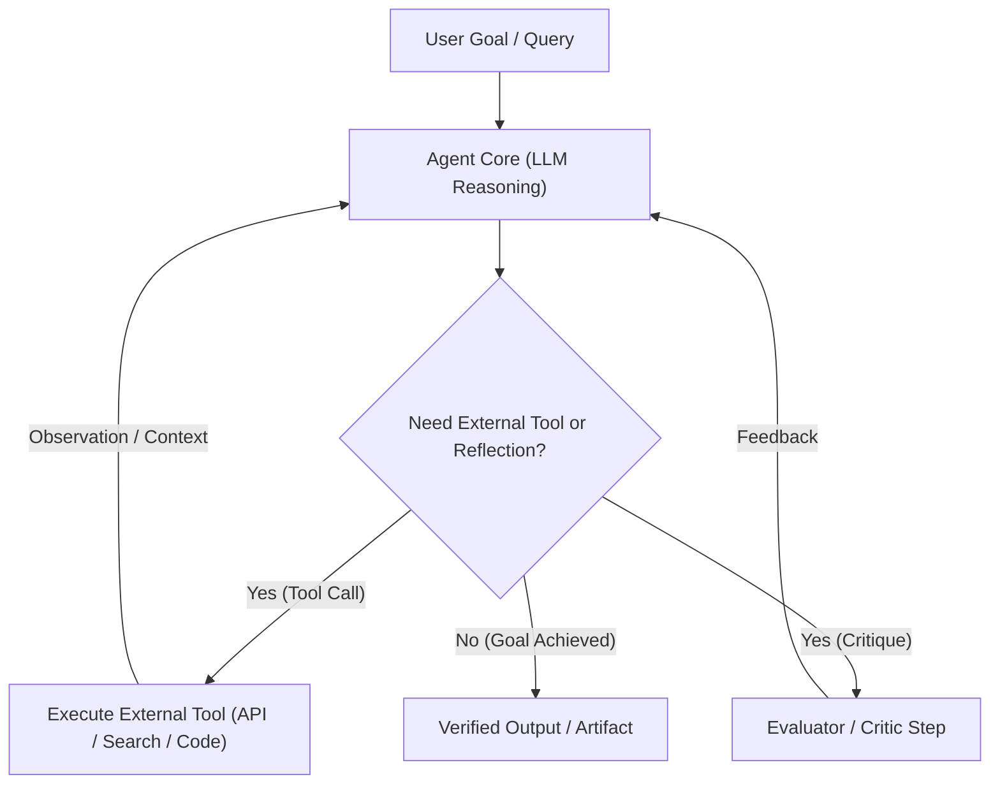
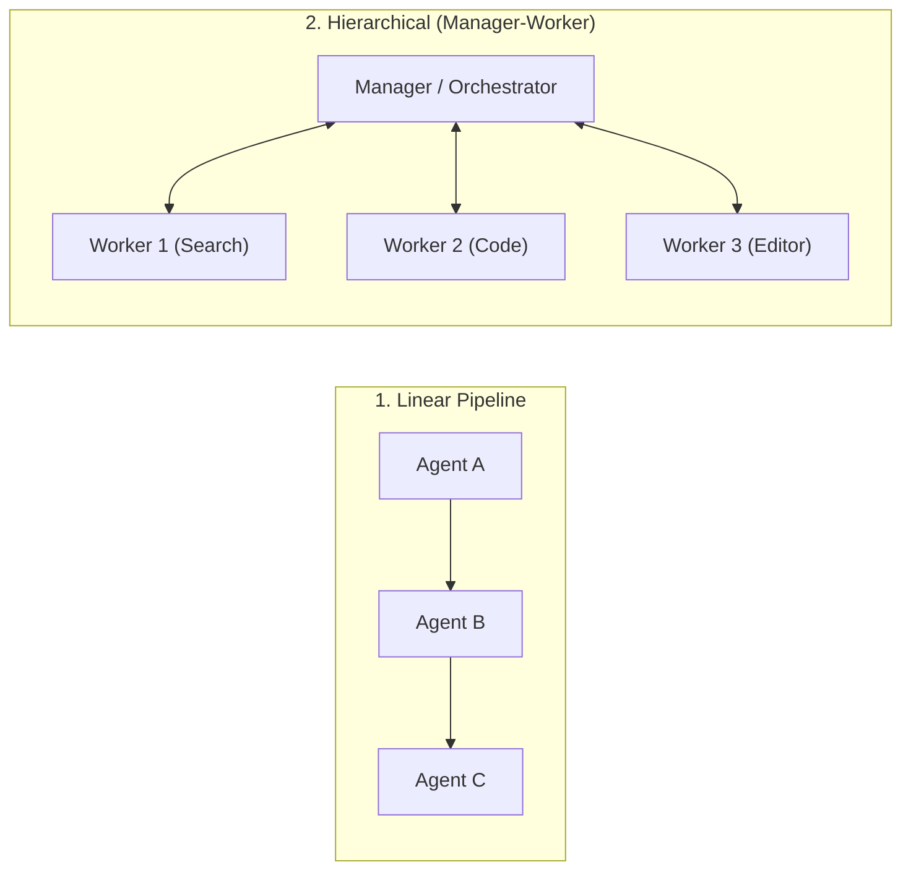

# 📚 Agentic AI: Comprehensive Study Guide & Engineering Manual

> **Learner:** Ahmed Rifai  
> **Course Track:** DeepLearning.AI — Agentic AI  
> **Purpose:** Detailed architectural notes, code patterns, theoretical foundations, and reference implementations for deep review and long-term portfolio mastery.

---

## 📑 Table of Contents
1. [Module 1: Foundations of Agentic AI & Autonomous Architectures](#module-1-foundations-of-agentic-ai--autonomous-architectures)
2. [Module 2: Reflection Design Patterns (Evaluator-Optimizer Loops)](#module-2-reflection-design-patterns-evaluator-optimizer-loops)
3. [Module 3: Tool Use, Function Calling & Schema Enforcers](#module-3-tool-use-function-calling--schema-enforcers)
4. [Module 4: Planning Patterns (Structured JSON vs Code Execution)](#module-4-planning-patterns-structured-json-vs-code-execution)
5. [Module 5: Multi-Agent Workflows & Communication Topologies](#module-5-multi-agent-workflows--communication-topologies)
6. [Laboratory Implementation Reference](#laboratory-implementation-reference)

---

## Module 1: Foundations of Agentic AI & Autonomous Architectures

### 1.1 The Shift from Single-Prompt LLMs to Agentic Loops
- **Zero-Shot Prompting Limitations:** Traditional LLM interactions are stateless, feed-forward text completions. The model generates text linearly without an execution environment, runtime feedback, or dynamic problem decomposition.
- **Agentic AI Paradigm:** An agent combines an LLM core with **memory**, **tools**, and **control loops** (Perceive $\rightarrow$ Reason $\rightarrow$ Act $\rightarrow$ Observe $\rightarrow$ Reflect).
- **Andrew Ng's 4 Core Agentic Design Patterns:**
  1. **Reflection:** The agent inspects its own output, critiques quality against rubrics, and refines iteratively.
  2. **Tool Use:** The agent queries external APIs, databases, web search engines, or execution runtimes.
  3. **Planning:** The agent anticipates subsequent steps, generates a dependency graph, and tracks execution state.
  4. **Multi-Agent Collaboration:** Different specialized agents exchange messages, negotiate, and distribute sub-tasks.

### 1.2 Agent Control Loop Architecture


---

## Module 2: Reflection Design Patterns (Evaluator-Optimizer Loops)

### 2.1 Theoretical Framework
In single-pass generation, LLMs often produce plausible yet shallow or structurally flawed drafts. **Reflection** separates generation from evaluation:
- **Generator (Drafter):** Emits candidate output based on instructions.
- **Evaluator (Critic):** Scrutinizes the draft against specific dimensions:
  - *Strengths:* What meets expectations?
  - *Limitations:* Where are factual or structural gaps?
  - *Suggestions:* Actionable modifications.
  - *Opportunities:* Broader improvements.
- **Optimizer (Reviser):** Incorporates the structured feedback into an updated draft.

### 2.2 Implemented Laboratory Workflow (`notebooks/C1M2_Reflection_in_a_Research_Agent.ipynb`)
```python
# 1. Draft generation
draft = generate_draft(topic="Quantum Computing in Cryptography")

# 2. Critical reflection
critique = reflect_on_draft(draft)

# 3. Revision incorporating critique
revised_essay = revise_draft(original_draft=draft, reflection=critique)
```

---

## Module 3: Tool Use, Function Calling & Schema Enforcers

### 3.1 Function Calling Mechanisms
- **Tool Schema Registration:** The agent provides JSON Schema definitions of available functions (`name`, `description`, `parameters`).
- **Autonomous Tool Selection:** By setting `tool_choice="auto"`, the LLM inspects the prompt, identifies missing information, and returns structured tool invocations (`tool_calls`) instead of prose.
- **Message Protocol:**
  - Assistant message includes `tool_calls` with unique `id`.
  - Tool execution occurs in the host environment.
  - Results are fed back with `role: "tool"`, `tool_call_id: call.id`, and serialized JSON content.

### 3.2 Implemented Laboratory Workflow (`notebooks/C1M3_Tool_Use_and_Reflective_Agents.ipynb`)
- **Integrated Research Tools:**
  - `arxiv_search_tool`: Searches arXiv academic papers and extracts metadata + PDF links.
  - `tavily_search_tool`: Real-time web search for recent developments.
- **Pipeline:** Tool-assisted research $\rightarrow$ JSON reflection critique $\rightarrow$ Clean HTML rendering.

---

## Module 4: Planning Patterns (Structured JSON vs Code Execution)

### 4.1 Planning Architectures
1. **Linear Plan:** Sequential step execution ($A \rightarrow B \rightarrow C$).
2. **Dynamic / Reactive Plan:** The agent inspects observations after each step and adjusts remaining tasks.
3. **Structured JSON vs Code-as-Action:**
   - *JSON Plans:* Declarative, predictable, easily constrained, but rigid.
   - *Code-as-Action:* The agent writes Python code containing loops and conditional logic. Extremely flexible, handles dynamic data structures, but requires safe sandboxed execution.

---

## Module 5: Multi-Agent Workflows & Communication Topologies

### 5.1 Communication Topologies


### 5.2 Implemented Laboratory Workflow (`notebooks/C1M5_Multi_Agent_Workflows.ipynb`)
In Module 5, a complete end-to-end multi-agent research company is implemented:
1. `PlannerAgent`: Analyzes the research topic and generates a strictly atomic list of research tasks ending in Markdown generation.
2. `ResearchAgent`: Executes queries using `arxiv_tool`, `tavily_tool`, and `wikipedia_tool` with autonomous tool calling up to 6 turns.
3. `WriterAgent`: Converts raw research outputs into an academic document.
4. `EditorAgent`: Performs peer-review reflection and refines the draft into a publication-ready Markdown report.

---

## Laboratory Implementation Reference

All completed, fully tested, and 100% verified notebooks are located in the [`notebooks/`](./notebooks) directory:
- [`C1M2_Reflection_in_a_Research_Agent.ipynb`](./notebooks/C1M2_Reflection_in_a_Research_Agent.ipynb)
- [`C1M3_Tool_Use_and_Reflective_Agents.ipynb`](./notebooks/C1M3_Tool_Use_and_Reflective_Agents.ipynb)
- [`C1M5_Multi_Agent_Workflows.ipynb`](./notebooks/C1M5_Multi_Agent_Workflows.ipynb)
